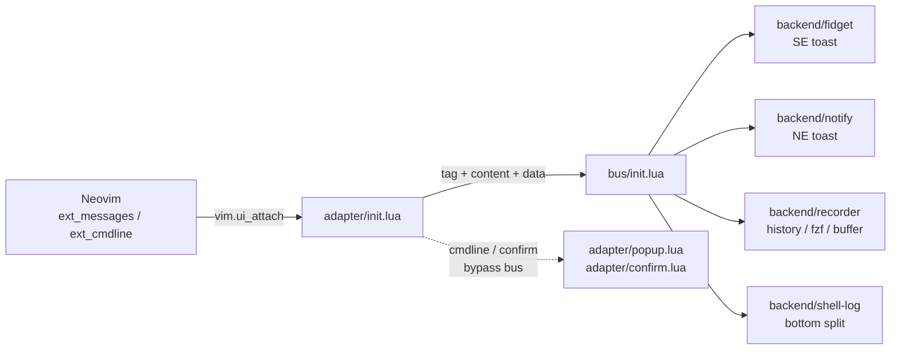

# UI events

The ui-events subsystem owns Neovim's message stream. It has three roles spread
across two directories: an **adapter** that turns `vim.ui_attach` events into
tagged messages, a **bus** that buffers and routes them, and **backends** that
render them. It exists for one reason: to show messages from early startup,
before a plugin such as noice has loaded.

## Why it exists

noice is large, and because it is a plugin it cannot see messages emitted before
it loads. The adapter is installed in `init.lua` phase 1, so `vim.notify` is
already routed when the rest of the config starts. The goal was to separate
event translation from presentation, and to give every producer a single exit.
The subsystem did achieve startup coverage; it did not achieve the clean
decoupling the three-part diagram suggests.

Before the bus existed, startup notifications were handled by a small
`LogQueue`: `vim.notify` calls were buffered and flushed once the notification
backend was available. The bus later absorbed that job with its `Ready` flag and
message queue. The `LogQueue` block at the top of `core/bus/init.lua` is kept as
a record of that earlier stage.

## The pipeline

The lifecycle has two stages:

- **Phase 1.** `core.adapter.setup()` runs before workspace, profile, language,
  and lazy: it calls `Bus.init()` (`Ready = false`), attaches `vim.ui_attach`,
  and replaces `vim.notify`.
- **`UIEnter`.** The four backends register, then `Bus.start()` sets
  `Ready = true` and flushes a bounded queue (`cache_max`, 2048).

The `ui_attach` callback returns `true` when it consumes an event and `false`
when Neovim should handle it. The adapter also applies policy: `echo`,
`echomsg`, `lua_print`, and `progress` are debounced for 20 ms into one
`msg.show.<kind>` with `data.batched = true`.

`confirm` is the exception: a `msg_show` with kind `confirm` is intercepted,
cmdline events go to `ConfirmHandlers`, and `emit_wrap` skips `vim.schedule` so
the prompt is drawn synchronously. Cmdline and confirm never enter the bus;
`popup.lua` and `confirm.lua` open windows directly.

## The message contract

| field       | role                                                        |
| ----------- | ----------------------------------------------------------- |
| `id`        | integer identity; preserved when a message replaces another |
| `tag`       | routing key; this is the real contract                      |
| `level`     | `vim.log.levels` value, filtered by subscriber `min_level`  |
| `content`   | `string` or `NvimMsgTuple[]`; renderers branch on the type  |
| `data`      | producer metadata, treated as opaque by the bus             |
| `timestamp` | `vim.uv.now()`                                              |
| `meta`      | flags such as `no_record` and `derived_from`                |

Tags are string literals repeated in the producer and in each consumer:

| tag                | producer                       | consumers                |
| ------------------ | ------------------------------ | ------------------------ |
| `notify`           | `vim.notify` override          | notify                   |
| `msg.show.<kind>`  | `on_msg_show` / batch flush    | fidget, notify, recorder |
| `msg.clear`        | `on_msg_clear`                 | fidget, notify, recorder |
| `msg.history_show` | `on_msg_history_show`          | recorder                 |
| `msg.show.shell_*` | `on_msg_show` (shell kinds)    | shell-log (prefix match) |
| `bus`              | bus internal log via observers | recorder, notify         |

`content` is either a string or `NvimMsgTuple[]`; renderers branch on it. `data`
is nominally opaque, but in practice it is `NvimMsgShowData`, which only `notify`
fully reads.

Subscribers declare `exact`, `prefix`, or `fuzzy` matchers plus `min_level`;
results are cached. Dispatch is synchronous; a handler runs under `pcall`, and
`true` stops the remaining handlers while `false` or `nil` continues. No backend
returns `true` today.

Emissions during dispatch go back into the queue. `flush_queue` drains in
batches, re-enters for new messages, and caps recursion at depth 4 before
dropping the queue. Messages are immutable; `Bus.dup` gives a copy a new
identity and records `meta.derived_from`, which the recorder uses to replay.

## Backends

| backend     | triggers                                                                                    | output                                 |
| ----------- | ------------------------------------------------------------------------------------------- | -------------------------------------- |
| `fidget`    | `msg.clear`, plus `msg.show.undo/echo/echomsg/unknown/bufwrite/progress/list_cmd/lua_print` | SE toast                               |
| `notify`    | `notify`, `msg.clear`, plus `msg.show.emsg/wmsg/echoerr/lua_error/rpc_error`                | NE toast                               |
| `recorder`  | selected `msg.show.*`, `msg.clear`, `msg.history_show`                                      | in-memory history, fzf, message buffer |
| `shell-log` | prefix `msg.show.shell_`                                                                    | bottom split                           |

`fidget` and `notify` are not two implementations of one policy: they are two
stacks with different anchors and disjoint message sets. Ordinary echoes land in
the bottom-right, errors and warnings in the top-right. The recorder keeps a
bounded history (1024 messages by default) and can replay through `Bus.dup`.

`recorder` and `notify` also register observers: they receive every bus-internal
`bus` message without tag or level filtering, which surfaces panics and queue
overflow without the bus depending on a renderer.

## Where the seams leak

1. **Views live in the adapter and bypass the bus.** `popup.lua` and
   `confirm.lua` are renderers, not translators; cmdline and confirm are state
   machines, not messages.
2. **The contract is strings and shapes.** Tag literals and `NvimMsgShowData`
   fields are repeated across adapter and backends; no schema module exists.
3. **Policy is duplicated.** Both toast backends map tags to titles, modes, and
   anchors, and both handle `msg.clear`; kind knowledge is split.
4. **Lifecycle is global and ordered.** Backends read a global `Bus`,
   registration must precede `Bus.start()`, and a missing backend silently
   drops messages.
5. **The bus is stateful.** `Ready`, `Queue`, `Busy`, `FlushDepth`, `RouteCache`,
   and `PanicBuffer` are state; re-entrancy control is the hard part.
6. **Observers are a side channel.** Internal logs skip subscriber matching;
   `notify` and `recorder` re-inject them through a second path with different
   filtering.
7. **Dispatch order is undefined.** `pairs(Subscribers)` decides order; if two
   handlers returned `true`, the winner would depend on table iteration.
8. **Sync and async paths interleave.** Ordinary messages use `vim.schedule`;
   `msg.clear` and history emit directly, so a clear can overtake an earlier
   batch.

## Lessons

- **Complexity is conserved.** The bus moved noice's complexity into startup
  lifecycle, re-entrancy, queueing, and per-backend policy.
- **A bus needs a schema, not just tags.** A second protocol doubles translation
  unless the inner protocol is normalized once, in one shared type.
- **Events are not states.** Cmdline and confirm do not fit a message stream;
  their views sitting in `adapter/` makes the layers look cleaner than they are.
- **Startup coverage is the differentiator.** If early capture is the
  requirement, design registration and queueing first; the router is easy.
- **Ownership must be explicit.** Replace, append, dismiss, batch, and replay
  should each have one owner; today they span adapter and backends.
- **Observability is architecture.** The panic buffer, `:checkhealth`, and the
  recorder make this much hidden state maintainable.
- **If rebuilding it:** use one schema with capabilities; make dispatch
  deterministic and registration explicit; remove the global locator; add
  focused tests.

## Verdict

This design is worth its cost when the config owns the whole process, needs
early startup messages, and accepts global `vim.ui_attach`/`vim.notify`. It is
not general-purpose: another UI extension cannot coexist.

As a noice replacement, it trades one large plugin for a smaller but still
coupled subsystem. The useful result is the startup coverage—and the knowledge
of why noice is large.
